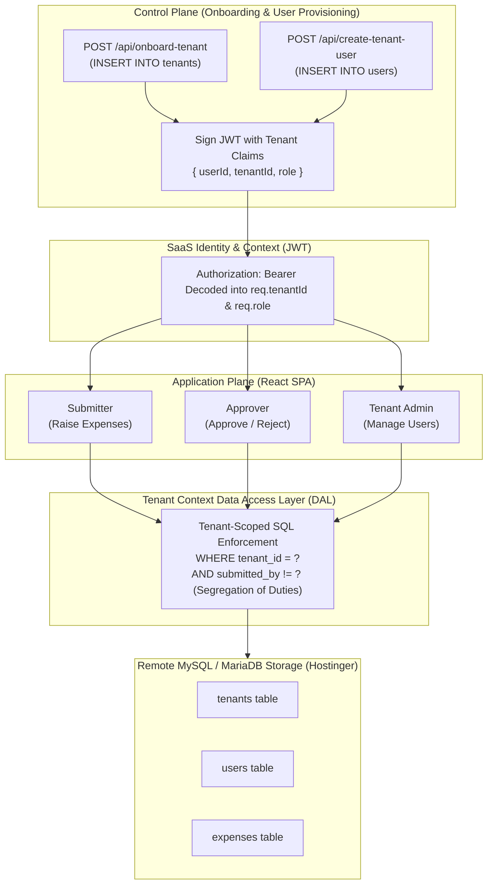

# Multi-Tenant SaaS Expense Management Application (MySQL Edition)

> **Architectural Framework**: Based on principles from Tod Golding's *Building Multi-Tenant SaaS Architectures* (AWS SaaS Factory).  
> **Tech Stack**: MySQL / MariaDB (Remote Hostinger / cPanel), Node.js Express (Control Plane & Data Access Layer), React + Vite + Tailwind CSS (Application Plane), Signed JWTs (Tenant Context).

---

## 🏛️ Core Architectural Pillars (Tod Golding Reference)

This application is designed specifically as a real-world reference implementation for learning multi-tenant SaaS architecture on relational databases.



### 1. Separation of Control Plane & Application Plane (Chapters 3 & 6)
- **Control Plane**:
  - Manages the *business of SaaS*: tenant registration, tenant metadata creation, and tenant administrator provisioning.
  - Endpoints: `POST /api/onboard-tenant` and `POST /api/create-tenant-user`.
  - Writes directly to the `tenants` table.
- **Application Plane**:
  - The business workload where day-to-day tenant activities occur (expense creation, review, and approval).
  - Interacts with `expenses` and `users` tables, strictly filtered by `tenant_id`.

### 2. SaaS Identity & Tenant Context (Chapters 4 & 5)
- Every authenticated request carries verified Tenant Context inside a signed **JSON Web Token (JWT)**:
  ```json
  {
    "userId": "usr_acme_submitter",
    "email": "submitter@acme.com",
    "displayName": "Sarah Submitter",
    "tenantId": "tenant-acme-prod",
    "role": "submitter"
  }
  ```
- The backend middleware verifies the signature and injects `req.tenantId` and `req.role` directly into the request pipeline.

### 3. Pooled Partitioning Architecture (Chapters 7 & 8)
- Uses the **Discriminator Column Pattern** in MySQL:
  - All tenant records share unified tables: `tenants`, `users`, `expenses`.
  - Every table has a non-nullable `tenant_id VARCHAR(64) NOT NULL` column with indexes:
    `KEY idx_expenses_tenant_created (tenant_id, created_at)`.

### 4. Infrastructure-Enforced Tenant Isolation (Chapter 9)
- Cross-tenant data isolation is **never** left to client-side filters.
- Every SQL query is parameterized with `WHERE tenant_id = ?`:
  ```sql
  SELECT * FROM expenses WHERE tenant_id = ? ORDER BY created_at DESC;
  ```
  If an Acme Corp user attempts to view or update a Beta Dynamics record, the query returns 0 rows.

### 5. Role-Based Access Control (RBAC) & Segregation of Duties (SOD)
Three roles are enforced per tenant:
1. `submitter`:
   - Can create new expense items (`status: 'pending'`, `submitted_by: req.userId`).
   - Can view expenses in their organization.
   - Can withdraw/delete their own pending expenses.
   - **CANNOT** approve expenses or edit other users' expenses.
2. `approver`:
   - Can review pending expenses and set `status: 'approved'` or `'rejected'`.
   - **Anti-Self-Approval Invariant**: Approvers **cannot** approve their own expenses. Enforced at the SQL layer:
     ```sql
     UPDATE expenses 
     SET status = ?, approved_by = ? 
     WHERE id = ? AND tenant_id = ? AND submitted_by != ?;
     ```
3. `admin` (Tenant Admin):
   - Can onboard new team members and assign their roles (`submitter`, `approver`, `admin`).
   - Can manage the tenant directory in MySQL.

---

## 📂 Directory Layout

```
├── backend/                   # Control Plane & DAL Express Server (Node.js)
│   ├── database/
│   │   ├── schema.sql         # Production MySQL schema DDL
│   │   └── seed.sql           # Initial multi-tenant demo seed data
│   ├── scripts/
│   │   └── migrate.js         # Automated remote MySQL migration runner
│   ├── db.js                  # MySQL connection pool & tenant query executor
│   ├── server.js              # Express REST APIs & JWT verification
│   ├── .env                   # Remote MySQL connection credentials
│   └── package.json
├── frontend/                  # Application Plane (React 18, Vite, Tailwind CSS)
│   ├── src/
│   │   ├── components/
│   │   │   ├── Header.jsx             # Tenant context badge & persona switcher
│   │   │   ├── SubmitterView.jsx      # Submitter workspace & expense form
│   │   │   ├── ApproverView.jsx       # Approver queue & Segregation of Duties
│   │   │   ├── AdminView.jsx          # Tenant user management & role assignment
│   │   │   ├── ArchitectureDrawer.jsx # Educational Tod Golding deep dive
│   │   │   └── OnboardingModal.jsx    # Self-service tenant signup modal
│   │   ├── context/
│   │   │   └── AuthContext.jsx        # JWT session & tenant state
│   │   ├── App.jsx
│   │   └── main.jsx
│   ├── dist/                  # Production static build for shared hosting
│   │   └── .htaccess          # Apache rewrite configuration for cPanel
│   └── package.json
├── DEPLOY_SHARED_HOSTING.md   # Complete step-by-step cPanel deployment guide
└── package.json               # Root scripts
```

---

## 🚀 Running the Project

```bash
# Terminal 1: Backend API (connects to remote MySQL at srv1674.hstgr.io)
npm run dev:backend

# Terminal 2: Frontend Client
npm run dev:frontend
```
Open **`http://localhost:3000`** in your browser.
